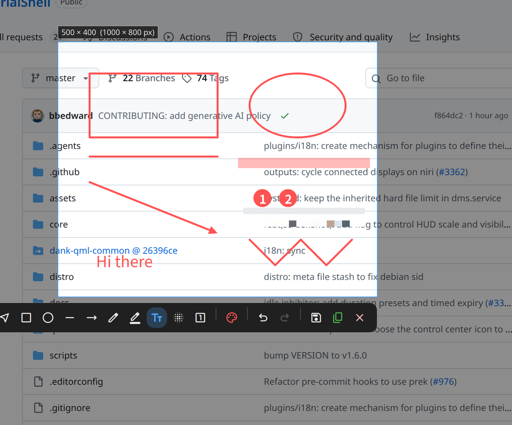

# Screenshot+

A [DankMaterialShell](https://github.com/AvengeMedia/DankMaterialShell) plugin for region screenshots with live annotation.

Drag out a selection, and the toolbar appears next to it. Draw on the picture right there, then move or resize the selection at any time: annotations stay anchored to the picture, and the toolbar follows the selection. No second window, no editor to launch.

- Nine tools: rectangle, ellipse, line, arrow, pen, highlighter, text, mosaic, numbered markers
- Select, move and delete annotations; undo and redo everything, including moves and deletes
- Eight preset colors plus a custom color picker; four sizes, remembered per tool
- Copy to the clipboard, save to a file, or both, with a notification that opens the file or its folder
- Pin the capture to the screen: it stays above your windows, can be moved and scaled, and is part of the next capture
- Select and copy text in the picture: double-click it as in a text box; [oar-ocr](https://github.com/greatv/oar-ocr) recognizes it
- The overlay is up about 80 ms after the shortcut
- Exports at the screen's native resolution on HiDPI displays; mosaics are computed on source pixels



## Install

Requires DankMaterialShell 1.6 or later.

**Optional: `ffmpeg` or ImageMagick. With one of them installed the overlay writes an uncompressed image and closes at once, and the PNG is encoded in the background. Without them Qt encodes the PNG on the shell's GUI thread, which takes about a second for a large selection.**

```bash
git clone https://github.com/pcmid/dms-screenshot-plus.git \
    ~/.config/DankMaterialShell/plugins/screenshotPlus

dms ipc call plugin-scan scan
dms ipc call plugins enable screenshotPlus
```

## Usage

Bind a key to:

```bash
dms ipc call screenshotPlus capture
```

For niri:

```kdl
Mod+Shift+S { spawn "dms" "ipc" "call" "screenshotPlus" "capture"; }
```

### Selection

| Action | Effect |
|---|---|
| Drag on the dimmed screen | Create the selection |
| Drag inside the selection (no tool active) | Move it |
| Drag one of the eight handles | Resize it |
| `F` | Select the whole screen under the pointer |
| `<` / `>` (or `,` / `.`) | Step back / forward through the regions of the last ten captures; `>` past the newest brings back the selection you had |
| `Enter` / `Space` | Finish as configured (copy to clipboard by default) |
| `Ctrl+C` / copy button | Copy to clipboard |
| `Ctrl+S` / save button | Save to file |
| `Ctrl+P` / pin button | Pin to the screen, see [Pinned images](#pinned-images) |
| `Esc` / right click | Step back: text being edited, then the selected annotation, then the active tool, then the capture |

The regions of exported captures are kept in DMS's plugin state, so they survive a shell reload. Regions that fall outside the current screens are skipped.

### Tools

| Tool | Key | How |
|---|---|---|
| Select | `S` | Click an annotation; drag to move; `Delete` removes; double-click text to edit it |
| Rectangle, ellipse, line, arrow, mosaic | `R` `E` `L` `A` `M` | Drag inside the selection |
| Pen, highlighter | `P` `H` | Draw inside the selection |
| Text | `T` | Click to start typing; `Enter` commits, `Shift+Enter` breaks the line, `Esc` cancels; input methods work |
| Number | `N` | Click to place the next number; removing one renumbers the rest |
| Undo, redo | `Ctrl+Z`, `Ctrl+Shift+Z` | |
| Clear all | | Toolbar button; removes every annotation, undoable |

The palette button opens the color and size panel. Each tool keeps its own size for the session, so a large pen does not make the text large.

The toolbar follows the selection. Drag the handle at its left end to put it anywhere; it stays there until a new selection is started.

### Pinned images

A pinned capture stays on screen above your windows, exactly where the selection was, until you close it. It is part of the next capture, so several regions can be collected into one picture. Keys go to the pin you clicked last; its border is brighter.

| Action | Effect |
|---|---|
| Drag | Move |
| Wheel, `+` / `-` | Scale around the pointer; `0` is back to 1:1 |
| `Ctrl` + wheel | Opacity |
| `Enter` / `Space` / `Ctrl+C` | Copy to clipboard |
| `S` / `Ctrl+S` | Save to file |
| Right click / `Tab` | Copy, save and close buttons |
| `Esc` / `Q` / double click / middle click | Close |

Pins last until they are closed or the shell is reloaded. Each pin is a transparent window the size of its screen that only takes input on the picture, so close the ones you are done with.

### Text recognition

With [oar](#setting-up-oar) set up, double-click text inside the selection to select it, as in a text box, or press the OCR button to outline all the text oar finds in it. Either recognizes the selection the first time, which takes a moment.

| Action | Effect |
|---|---|
| `O` / OCR button | Outline the recognized text; again to stop |
| Double click | Select a word; in Chinese and Japanese, which have no spaces between words, the characters up to the next punctuation |
| Triple click | Select the line |
| Drag over text | Select text, across lines |
| `Shift` + click | Extend the selection |
| `Ctrl+A` | Select all recognized text |
| `Ctrl+C` / `Enter` / copy button | Copy the selected text; the overlay stays open |
| `Esc` / right click | Leave text selection; while recognizing, stop |

A press anywhere but on recognized text leaves text selection and does what it always does. Picking a drawing tool leaves it too, and moving or resizing the selection drops what was recognized.

#### Setting up oar

Text is recognized by [oar-ocr](https://github.com/greatv/oar-ocr), which runs PaddleOCR's PP-OCRv6 models on the CPU. It reads Chinese, English and 46 other languages in Latin script with no setup, usually in well under a second. Install it:

```bash
cargo install oar-ocr-cli
```

Then enter its path, normally `~/.cargo/bin/oar`, under Text recognition in the settings: the shell's `PATH` usually lacks `~/.cargo/bin`. The Test button runs it on a sample picture. The first run downloads the models into `~/.oar`, 6 MB for the default `--size tiny`. With `--size small` as arguments, oar is more accurate on some text and reads Japanese as well, and takes about twice as long.

Screenshot+ runs `oar ocr <arguments> --format json` on the selection without annotations, at the screen's native resolution.

### Settings

DMS Settings, Plugins, Screenshot+:

- **Toolbar**: one switch per tool. Disabled tools are hidden and lose their shortcut.
- **Default style**: color and size at the start of each capture.
- **Output**: what `Enter` does: copy to clipboard, save to file, pin to screen; save directory (empty for the Screenshots folder in your Pictures directory), file name as a `date` format without the extension (empty for `screenshot-%Y%m%d-%H%M%S`), notification.
- **Backend**: `cli` or `screencopy`, see [Backends](#backends).
- **Text recognition**: the path of oar, empty to turn text selection off, its arguments, and a button to test it; see [Setting up oar](#setting-up-oar).

## Backends

Both backends freeze the screen under the overlay, so the dimmer and the annotations are drawn over a still image while the desktop keeps running underneath.

**cli** (default) runs `dms screenshot output` for every screen before the overlay is mapped, writes the frames as PNG files to `$XDG_RUNTIME_DIR/screenshot-plus` and loads them into an `Image`. The overlay appears immediately and fully transparent, the dimmer is drawn as soon as the grab has returned, and the decoded frame replaces the live desktop a moment later. The switch is invisible because both show the same picture. This backend works with any Quickshell.

**screencopy** captures the frame in-process through Quickshell's `ScreencopyView`, which speaks the wlr-screencopy protocol directly to the compositor. Nothing is encoded, written or decoded, so the frame is on screen about three times sooner. Current stock Quickshell (0.3.1 and master alike) crashes the whole shell when the overlay closes: its screencopy backend binds a second `wl_output` with Qt's own listener, QtWayland mistakes that object for a screen and dereferences it after it has been freed. The analysis and a fix are in [quickshell#1094](https://github.com/quickshell-mirror/quickshell/issues/1094); the fix is not merged yet. Choose this backend only with a Quickshell that includes it.

With either backend the export reuses the frame texture through a `ShaderEffectSource` sampled at the screen's native resolution, so both produce the same output.

## IPC

```
dms ipc call screenshotPlus capture   # open the overlay
dms ipc call screenshotPlus finish    # export as configured and close
dms ipc call screenshotPlus cancel    # close without exporting
```

## Development

Clone anywhere and symlink into the plugins directory:

```bash
git clone https://github.com/pcmid/dms-screenshot-plus.git
ln -s "$PWD/dms-screenshot-plus" ~/.config/DankMaterialShell/plugins/screenshotPlus
dms ipc call plugin-scan scan
dms ipc call plugins enable screenshotPlus
```

After editing, reload the whole shell so that imported files are picked up:

```bash
systemctl --user reload dms
```

Component errors and `console.warn` output appear in `journalctl --user -u dms`.

| File | Role |
|---|---|
| `ScreenshotPlusDaemon.qml` | Session state, frozen frames, export handling, IPC |
| `CaptureOverlay.qml` | One layer-shell window per screen: selection, pointer and keyboard handling, export |
| `PinnedImage.qml` | One window per pinned capture: moving, scaling, copy / save / close |
| `OcrRunner.qml` | One run of oar: output, errors, timeout |
| `AnnotationLayer.qml` | The exported subtree (frame, mosaics, strokes) plus the selection outline and text editor |
| `Toolbar.qml` | Toolbar and color / size panel |
| `ScreenshotPlusSettings.qml` | Settings page |
| `lib/Tools.js` | Tool registry: icons, shortcuts, interaction kinds, size presets |
| `lib/Renderer.js`, `lib/Hit.js` | Drawing and hit-testing of strokes |
| `lib/Config.js` | Setting defaults |
| `lib/finalize.sh` | Post-export: convert to PNG, save, notify |
| `lib/Ocr.js` | oar's command line and output, and selecting recognized text |
| `translations/<locale>.json` | UI strings; add a file to add a language |
